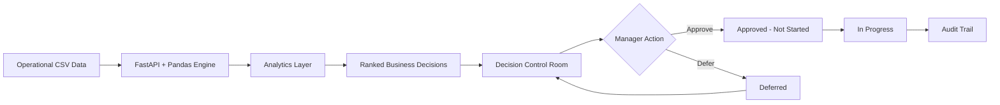
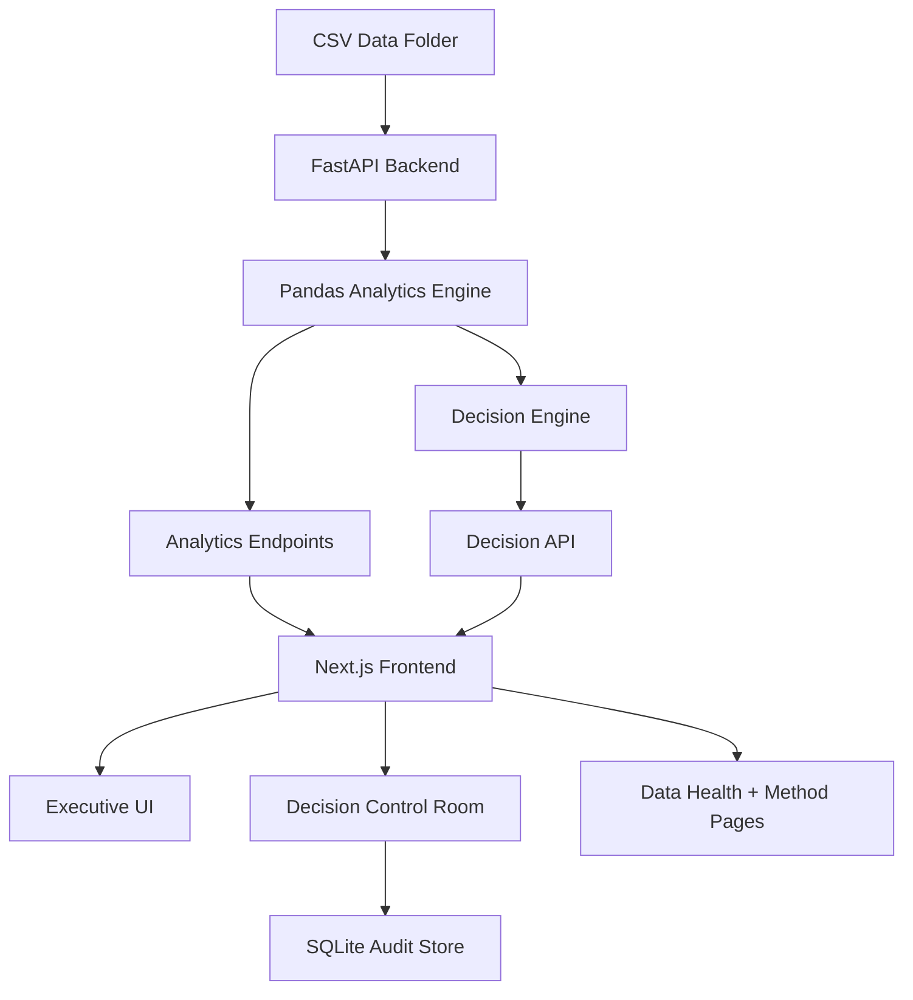

The challenge is not simply “make a dashboard.”

The real challenge is connecting the business chain and finding where money, time, stock, and operational performance are being lost.

This project focuses on:

- profit leakage
- supplier reliability
- inventory risk
- dead stock and trapped capital
- channel performance
- customer behavior
- quality losses
- marketing efficiency
- production and printing performance
- executive decision tracking

---

## Product concept

### Executive Operations AI

The platform acts like an internal operations control layer.

It does four things:

1. **Reads operational CSVs**
2. **Computes business metrics**
3. **Ranks recommended actions**
4. **Tracks decisions through an approval workflow**

The main experience is the **Decision Control Room**, where each recommendation becomes an action card.

Example action:

```text
Escalate supplier Approved Supplier 09
Estimated impact: EGP 49.9M
Owner: Procurement Manager
Reason: Late or rejected deliveries disrupt production and inflate material cost.
```

---

## Main modules

| Module | Purpose |
|---|---|
| **Command Center** | Executive overview of revenue, margin, trapped capital, stockout risk, trends, and top actions |
| **Decision Control Room** | Kanban workflow for AI-ranked decisions: awaiting, deferred, approved, in progress |
| **Action Center** | Groups recommended actions by owner and department |
| **Time Machine / Audit Trail** | Tracks approval/defer/start actions with timestamps |
| **Profit Leakage** | Shows conservative and inclusive leakage estimates with formulas |
| **Channels** | Compares Retail, Online, and Wholesale performance |
| **Customers** | RFM-style customer segmentation and repeat behavior |
| **Inventory & Forecast** | Overstock, stockout risk, ABC/XYZ logic, and forecast methods |
| **Marketing** | Campaign ROAS, platform performance, and budget reallocation estimates |
| **Operations** | Production, printing, downtime, capacity, and bottleneck indicators |
| **Quality & Returns** | QC defects, return patterns, and corrective-action priorities |
| **Supply Chain** | Supplier on-time rate, quality score, spend exposure, and action matrix |
| **Data Health** | Reconciliation checks so metrics do not silently break |
| **Method & Coverage** | Formula, source table, assumption, and modeled-data transparency |

---

## Key project idea

Most dashboards stop at:

```text
Here is what happened.
```

This project goes further:

```text
Here is what happened.
Here is why it matters.
Here is the recommended action.
Here is the estimated EGP impact.
Here is who owns it.
Here is the audit trail.
```

---

## Decision lifecycle



---

## Architecture



---

## Tech stack

| Layer | Tools |
|---|---|
| **Frontend** | Next.js 14, React, TypeScript, Tailwind CSS |
| **Charts / UI** | Recharts, lucide-react, custom dark SaaS components |
| **Backend** | FastAPI, Python |
| **Analytics** | pandas, numpy |
| **Decision logic** | Rule-based business heuristics, threshold logic, formulas |
| **Audit store** | SQLite |
| **Data source** | Provided CSV files |

---

## Data note

This project uses operational CSV files provided for the HVIA internship task.

Some tables are marked as modeled or training operational data. Because of that, the outputs should be interpreted as a **business-intelligence and decision-intelligence exercise**, not audited financial statements.

Important:

```text
Do not publish the /data folder publicly.
```

For a public GitHub version:

```text
The /data folder is excluded for confidentiality.
To run locally, place the provided CSV files inside /data at the project root.
```

---

## Project structure

```text
El_Sharnouby_Operations_Control/
│
├── backend/
│   ├── main.py
│   ├── decision_engine.py
│   ├── store.py
│   ├── analytics/
│   │   └── stage2.py
│   ├── tests/
│   └── requirements.txt
│
├── frontend/
│   ├── src/
│   │   ├── app/
│   │   ├── components/
│   │   ├── hooks/
│   │   └── lib/
│   ├── package.json
│   └── tailwind.config.ts
│
├── data/
│   └── provided CSV files
│
└── README.md
```

---

## Quick start on Windows

### 1. Install requirements

Install:

- Python 3.11 or newer
- Node.js 20 LTS or newer

Check in PowerShell:

```powershell
python --version
node --version
npm --version
```

---

### 2. Run the backend

Open PowerShell in the project folder:

```powershell
cd path\to\El_Sharnouby_Operations_Control\backend
python -m venv .venv
.venv\Scripts\Activate.ps1
python -m pip install --upgrade pip
pip install -r requirements.txt
python -m uvicorn main:app --port 8001
```

Backend:

```text
http://localhost:8001
```

API docs:

```text
http://localhost:8001/docs
```

Quick check:

```text
http://localhost:8001/api/overview
```

---

### 3. Run the frontend

Open a second PowerShell window:

```powershell
cd path\to\El_Sharnouby_Operations_Control\frontend
npm install
$env:NEXT_PUBLIC_API_URL="http://localhost:8001"
npm run dev
```

Frontend:

```text
http://localhost:3000
```

If port `3000` is busy, Next.js may use another port like:

```text
http://localhost:3001
```

---

## Quick start on macOS / Linux

Backend:

```bash
cd backend
python -m venv .venv
source .venv/bin/activate
pip install -r requirements.txt
python -m uvicorn main:app --port 8001
```

Frontend:

```bash
cd frontend
npm install
NEXT_PUBLIC_API_URL=http://localhost:8001 npm run dev
```

For fish shell:

```fish
cd backend
python -m venv .venv
source .venv/bin/activate.fish
pip install -r requirements.txt
python -m uvicorn main:app --port 8001
```

Frontend in fish:

```fish
cd frontend
npm install
env NEXT_PUBLIC_API_URL=http://localhost:8001 npm run dev
```

---

## API overview

| Endpoint | Purpose |
|---|---|
| `/api/overview` | Executive KPIs |
| `/api/dashboard` | Command Center data |
| `/api/decisions` | Ranked decisions for the control room |
| `/api/decisions/{id}/transition` | Approve, defer, or start a decision |
| `/api/audit` | Decision history |
| `/api/leakage` | Profit leakage analysis |
| `/api/channels` | Channel performance |
| `/api/customers` | Customer segmentation |
| `/api/inventory` | Inventory risk and ABC/XYZ logic |
| `/api/forecast` | Forecast and replenishment logic |
| `/api/marketing` | Campaign and platform metrics |
| `/api/operations` | Production, printing, and downtime |
| `/api/quality` | Defects, returns, and corrective actions |
| `/api/supply` | Supplier performance and risk |
| `/api/data-health` | Reconciliation checks |
| `/api/method` | Formulas, sources, assumptions |
| `/api/story` | Executive narrative |
| `/api/scenario` | Scenario / what-if estimates |

---

## Data-health philosophy

The app includes a Data Health page because dashboards can look polished while the numbers are wrong.

The backend checks things like:

- revenue reconciliation
- leakage totals
- decision ID uniqueness
- mocked/fallback tables
- row counts
- NaN-safe API output
- inventory snapshot logic

This makes the project more defensible in discussion.

---

## Method honesty

Every important metric should be explainable by:

```text
Metric = formula + source table + assumption + modeled/recorded label
```

Examples:

| Metric | Example formula |
|---|---|
| Gross margin | gross profit / net sales |
| Stockout exposure | stockout days × avg daily sales × unit gross profit |
| Discount leakage | retail/online gross sales × excess discount above cap |
| Supplier exposure | supplier spend × late delivery risk |
| Trapped capital | idle units × unit cost |

The project avoids presenting estimates as guaranteed facts.

---

## What makes this project different

This is not only a BI dashboard.

It combines:

- operational analytics
- ranked decision recommendations
- executive storytelling
- auditability
- role-based action workflow
- formula transparency
- data-health checks
- scenario thinking

The result is closer to an **operations decision platform** than a normal report.

---

## Generated folders intentionally excluded

These folders/files are generated locally and should not be committed to GitHub:

```text
frontend/node_modules/
frontend/.next/
backend/.venv/
backend/__pycache__/
backend/.pytest_cache/
backend/warroom.db
data/
```

To recreate them:

```text
pip install -r requirements.txt
npm install
```

This is normal for Python and JavaScript projects.

---

## Public vs private submission

### Private HVIA submission

The private submission can include:

```text
data/
```

because the reviewer needs the provided CSVs to reproduce the results.

### Public GitHub / LinkedIn version

The public version should exclude:

```text
data/
```

and keep this note:

```text
The /data folder is excluded for confidentiality.
To run locally, place the provided CSV files inside /data at the project root.
```

---

## Honest limitations

This project was built for an internship challenge using provided operational CSVs.

Limitations:

- Some data is modeled/training data.
- Financial outputs are analytical estimates, not audited statements.
- Forecasts are simple business-rule forecasts, not a production ML forecasting system.
- Some recommendations use heuristic thresholds rather than trained optimization models.
- A production version would need stakeholder validation, live ERP integration, permissions, deployment, and monitoring.

---

## Roadmap

Future improvements:

- connect to ERP / POS / inventory systems
- add authentication and real user roles
- deploy backend and frontend
- add Product 360 pages
- add supplier contract data
- improve forecasting with seasonality and confidence intervals
- add scenario sliders for management planning
- add exportable executive PDF reports

---

## Final note

The goal of this project is to show how raw business operations data can become:

```text
Insight → Decision → Action → Audit Trail
```

That is the core idea behind **El-Sharnouby Operations Control**.
```

Use that as the full README.
